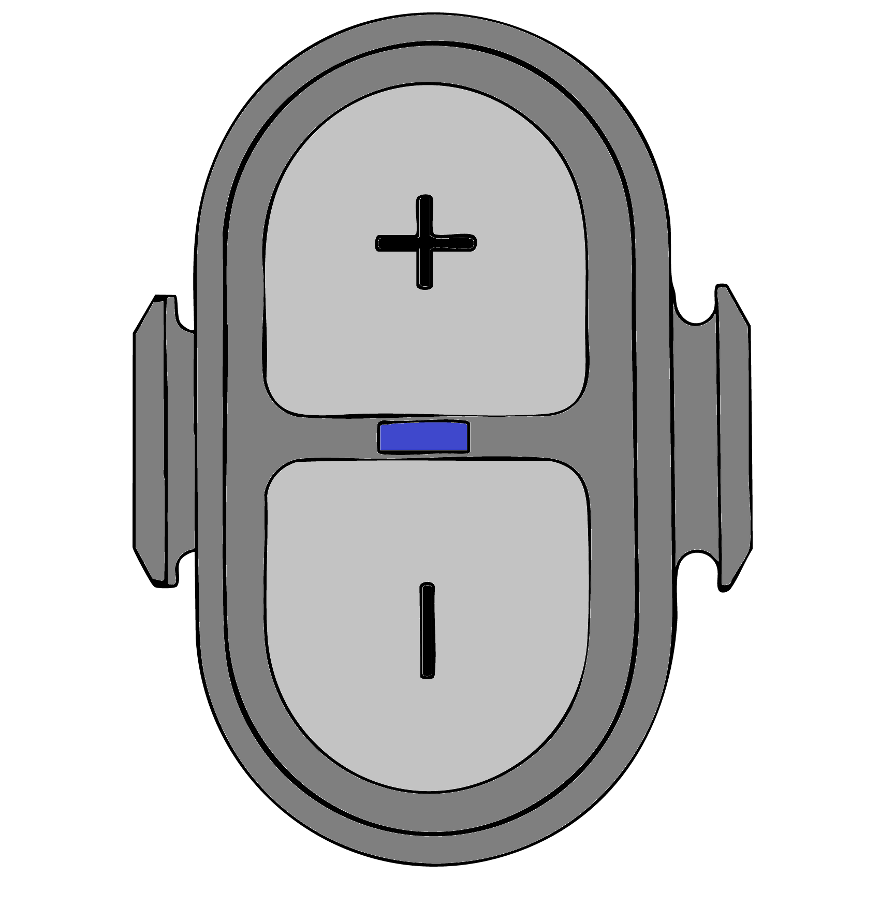
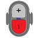

# ThinkRider VS200 Virtual Shifter (Custom Windows Tray Fork)





> Pre-built Windows binary (`tray.exe`) with custom status icons, embedded `.ico` icon, and silent startup is available on the **[Releases](../../releases)** page.

## Fork Improvements & Features
* **Visual Status Tray Icons:** Clear connection feedback in the Windows system tray — a **green `+`** icon when the ThinkRider VS200 remote is connected and active, and a **red `-`** icon when disconnected or searching.
* **Custom Embedded Executable Icon:** Custom `.ico` icon built directly into `tray.exe` for Windows Explorer, desktop shortcuts, and the taskbar.
* **Silent Startup (Notifications Disabled by Default):** Pop-up Windows toast notifications are turned off by default so they do not interrupt fullscreen rides (can still be enabled anytime via the tray right-click menu).
* **Automated Cloud Builds:** Includes a GitHub Actions workflow (`.github/workflows/build.yml`) that automatically compiles `tray.exe` on every commit and attaches binaries to Releases.

### Credits
* Controller artwork and icon base adapted from the **[OpenBikeControl / BikeControl](https://github.com)** project.

---

# Think Rider BLE Utility


A bridge between your ThinkRider VS200 and MyWhoosh Virtual Shifter on your
computer. This utility allows you to connect the buttons on your VS200 device
and shift up and down the virtual gears on.


## Context

This started as a simple port of <https://github.com/yudojurou/vs200_switch>
from Python to Rust.

It them became an over-engineering exercise to make a small UI utility I can
use outside of the terminal.

I'm used to writing CLIs and Web services in Rust, but not as much as UI (I
often reach for Flutter instead). The port became a tray executable, and an dev
exercise on using channels for updates insted of `Arc<RwLock<T>>`.

The goal is to be a small binary, portable across OS and use little resources
as possible.


## Features

- [x] Bluetooth LE device discovery and connection
- [x] Automatic connection on start
- [x] VS200 battery data
- [x] Simulate keyboard key presses to shift gear on MyWhoosh (requires MyWhoosh in foreground)
- [ ] Support [OpenBikeControl](https://github.com/OpenBikeControl/bikecontrol) protocol to shift gears (allow other apps in foreground)

Platforms:
 - Linux: `untested`
 - MacOs: `untested`
 - Windows: `target`

The crates chosen should work on other platforms, but I lack the hardware at this moment to confirm it's working.

## Getting Started

The app is designed to connect directly to the ThinkRider VS200 device.
Disconnect the VS200 from the trainer before using this utility, as MyWhoosh
will be the one deciding the effort and virtual gears.

There are 2 ways to run this app, either from the terminal or as a GUI from the
application tray. Both use the same core library and utility.

### Terminal

You can run it directly with:

```sh
cargo run --release --bin cli
```

### Tray (UI)

You can build the binary using the following command:

```sh
cargo build --release --bin tray
```

Then the binary will be available on `target/release/tray.exe`.
You should be able to copy it to another directory.
